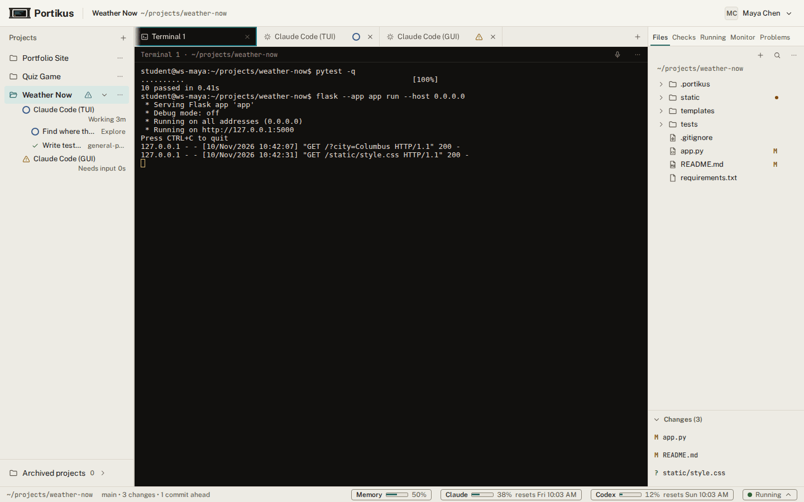
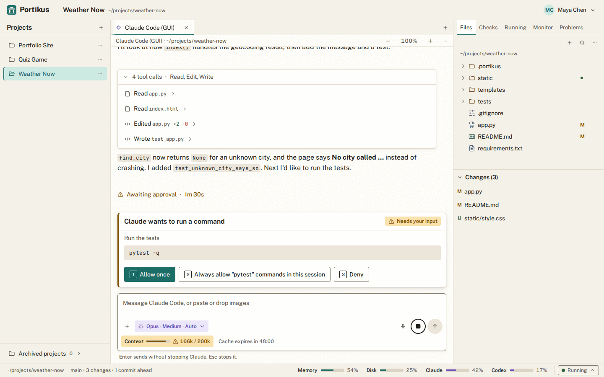
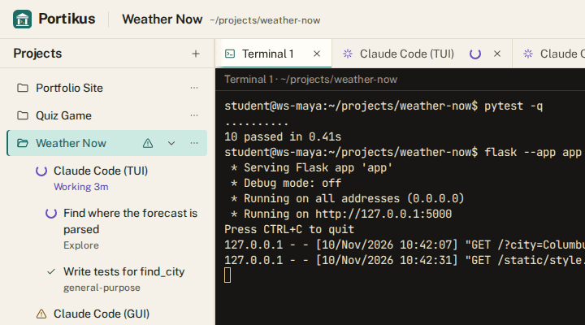
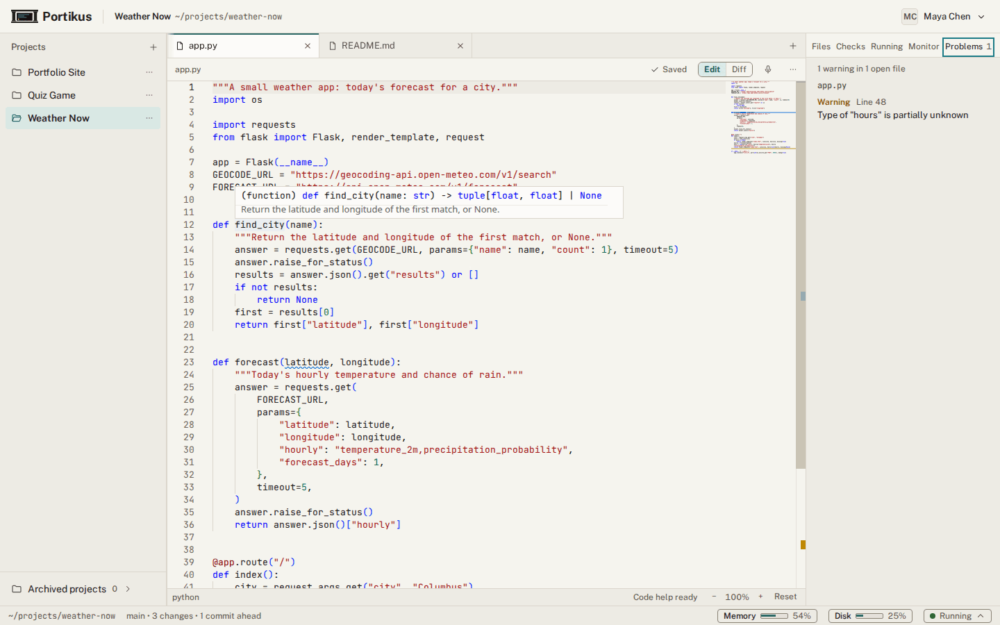
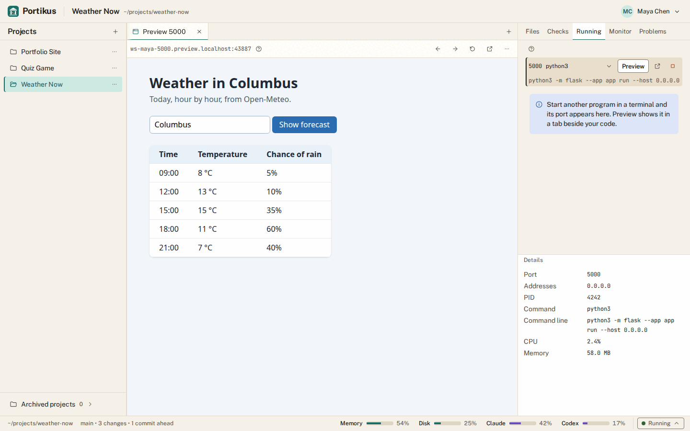
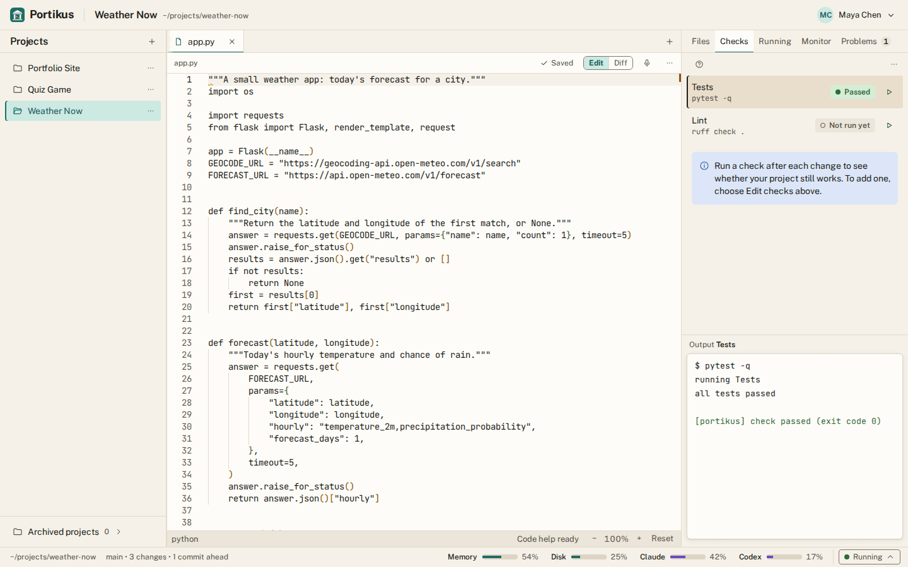
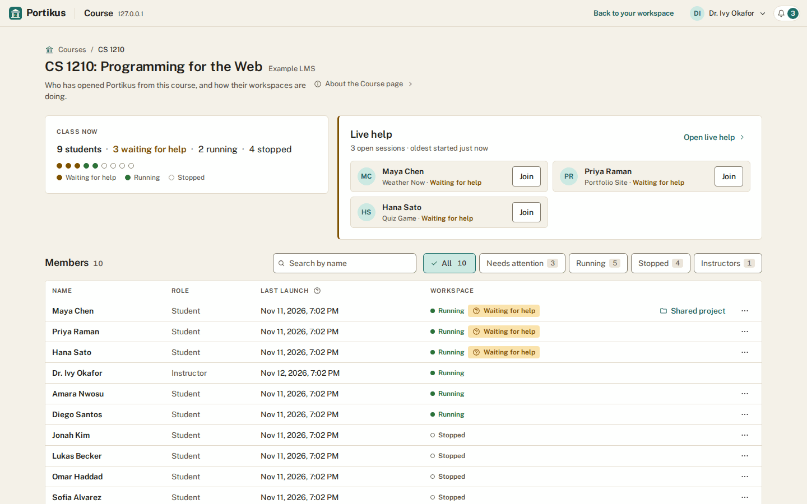
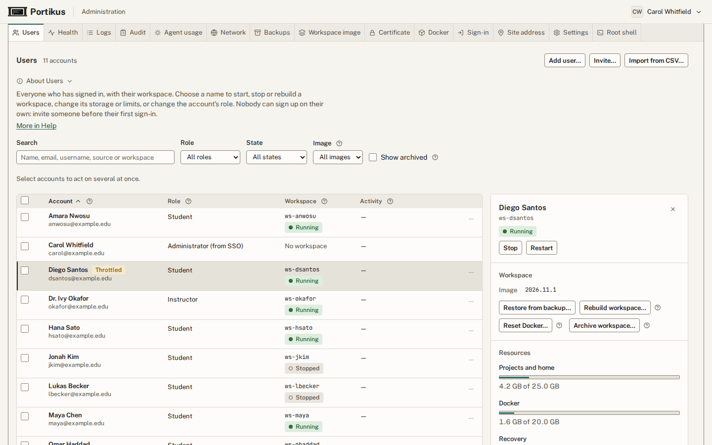

<picture>
  <source media="(prefers-color-scheme: dark)" srcset="design/system/assets/Logos/portikus-wordmark-paper.svg">
  
</picture>

Portikus gives every student in a class a real Linux development workspace,
with coding agents built in, that opens in an ordinary web browser. It is
for courses that teach agentic software development: building software
with an AI coding agent such as Claude Code or Codex.

Students skip the week of installing runtimes, Docker and command-line
tools on their own laptops. They still learn the real tools: real Git, real
Docker, real shells and the real agent programs. Portikus simplifies access
to the development environment, not the environment itself. Instructors
and administrators get a course page, usage counts, live help and full
control of every workspace.

## A tour

<picture>
  <source media="(prefers-color-scheme: dark)" srcset="docs/images/student-shell-dark.png">
  
</picture>

A student's workspace. Projects and their running agents are on the left,
a terminal, a Claude Code TUI tab and a Claude Code chat tab in the middle,
and the project's files and Git changes on the right. The status bar shows
the Git branch, memory and disk use, and each agent provider's seven-day
plan usage as a percent with its reset time, such as "Claude 38% resets
Fri 10:09 AM".

Claude Code in the chat tab. The agent's tool calls are grouped, and a
card asks the student before it runs a command. Pickers below the message
box set the model and the permission mode.

Each agent, and each subagent it starts, has a row under its project that
shows whether it is working, needs the student's input, or is done.

The editor has code help for Python, TypeScript and JavaScript:
completion, hover, go to definition, rename, formatting and error marks,
collected in a Problems tab.

A web app the student is running, previewed in a tab. Only the student can
open it, after signing in.

Checks run the commands a project lists, such as its tests and lint, with
one click, and show the output.

An instructor's Course page: open live-help sessions, roster sync, the
student interface (Agentic or Traditional), and each member's workspace.

Administrators find a person on the Users tab and act on their workspace:
start, stop, rebuild, restore, and change storage and limits. Other tabs
cover backups, health, logs, audit, network access, the certificate and
settings.

## What students get

- **Coding agents.** Claude Code runs as a TUI (a text interface in a
  terminal tab) or in the GUI chat tab. Codex runs in a terminal tab. The
  New tab menu offers Terminal, Claude Code (TUI), Claude Code (GUI) and
  Codex.
- **Terminals** that keep running when the browser tab closes, for the
  ten-minute grace period after the student leaves.
- **An editor** that saves as you type, with code help and a Markdown
  preview.
- **Previews** of the web apps they run, at a private address.
- **Checks**, the project's tests and other commands, one click away.
- **Recovery points**: snapshots of a project, stored outside it, that
  can be restored after a mistake.
- **Live help**: a student can invite one of their instructors to watch,
  and if allowed type in, their project's terminals and previews for up to
  an hour.
- **Course profiles.** A course set to Traditional hides the agent
  launchers for a class taught without agents; Agentic shows them.
- **A phone layout**, with the side panes as drawers.

## How it works

One Debian server runs the platform. Each person gets their own isolated
container on it, with Docker inside, and their files on storage that
survives stops and rebuilds. Coding agents run inside that container as
the student, as ordinary programs, on the same files the student sees.
Student code, including code an agent wrote, is treated as untrusted:
previews are served from a separate web address and need the student's
sign-in.

The platform never commits, branches, tags or stashes in a student's Git
repository; the Git status it shows is the real one. A workspace stops ten
minutes after its last browser tab closes. Files, Git and Docker data
survive the stop; running processes do not.

[docs/OVERVIEW.md](docs/OVERVIEW.md) has the architecture and the design
rules.

## Install

Portikus installs with `apt install portikus` on a Debian 13 x86-64
server. A few text screens ask for the web address, the administrator's
email, how people sign in (local accounts, Microsoft Entra ID, Google
Workspace, LDAP or Active Directory, or another OpenID Connect provider)
and where to keep student files. [docs/INSTALL.md](docs/INSTALL.md) walks
through every step, and [docs/HOSTING.md](docs/HOSTING.md) says what size
of server suits a class.

## Develop

You need Node.js at the version in `.nvmrc`, pnpm through corepack, and
Docker for a throwaway PostgreSQL. `make check` runs the type checks,
lint, tests, build and infrastructure checks; `make help` lists every
target. [docs/WORKFLOW.md](docs/WORKFLOW.md) covers local development,
branching, pull requests and CI.

## Documentation

| Document | What it is |
|---|---|
| [docs/STUDENT-GUIDE.md](docs/STUDENT-GUIDE.md) | Using a workspace, for students |
| [docs/INSTRUCTOR-GUIDE.md](docs/INSTRUCTOR-GUIDE.md) | The Course page, roster sync, the student interface, starter projects, agent use, shared projects and live help, for instructors |
| [docs/ADMIN-GUIDE.md](docs/ADMIN-GUIDE.md) | Running Portikus, for administrators |
| [docs/INSTALL.md](docs/INSTALL.md) | Installing on a Debian 13 server |
| [docs/OPERATIONS.md](docs/OPERATIONS.md) | The operator's runbook: upgrades, backups, restore, routine checks |
| [docs/HOSTING.md](docs/HOSTING.md) | Choosing a server |
| [docs/CAPACITY.md](docs/CAPACITY.md) | Load test results and sizing |
| [docs/OVERVIEW.md](docs/OVERVIEW.md) | One-page orientation and the design rules |
| [docs/VISION.md](docs/VISION.md) | Product intent |
| [docs/SPEC.md](docs/SPEC.md) | Requirements |
| [docs/STACK.md](docs/STACK.md) | Technology choices and why |
| [docs/DESIGN.md](docs/DESIGN.md) | The visual design |
| [docs/BROWSER-HANDLING.md](docs/BROWSER-HANDLING.md) | Previews and browser requests from command-line tools |
| [docs/WORKFLOW.md](docs/WORKFLOW.md) | Development, branching, review and CI |
| [docs/HOW-WE-WORK.md](docs/HOW-WE-WORK.md) | How this project works with AI agents |
| [docs/adr/](docs/adr) | Decision records |

The same help for students, instructors and administrators is built into
Portikus on its Help page.

## Status

[docs/STATUS.md](docs/STATUS.md) records what has been delivered and the
gaps that remain.

## Contributing and security

See [CONTRIBUTING.md](CONTRIBUTING.md) to contribute and
[SECURITY.md](SECURITY.md) to report a vulnerability privately. Everyone
taking part follows the [Code of Conduct](CODE_OF_CONDUCT.md).

Licensed under the [MIT License](LICENSE).
