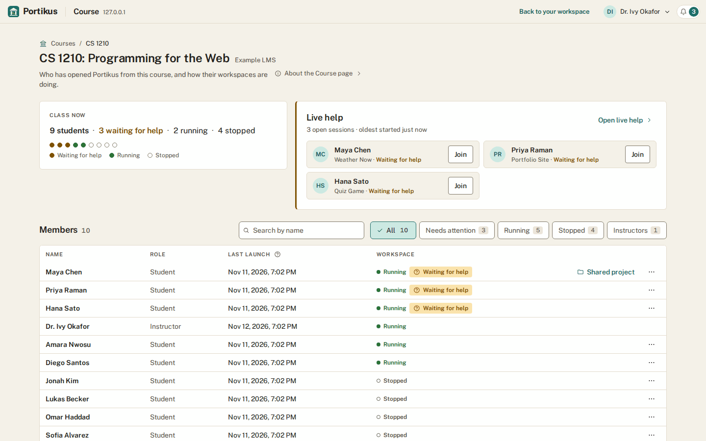
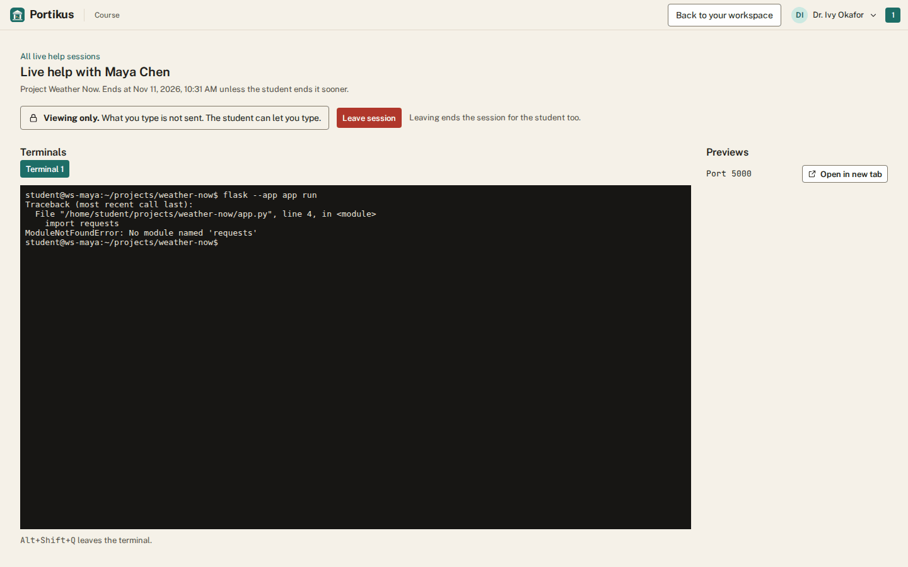

# Instructor guide

This guide is for instructors who teach with Portikus through a learning
management system (LMS), such as Canvas or Moodle. Administrators can teach
too, and the same pages work for them. Running the site itself is in
[ADMIN-GUIDE.md](ADMIN-GUIDE.md).

Portikus has the same help built in: **For instructors** on the Help page.

## The Course page

Once you open Portikus from a course you teach in your learning system, a
**Course** link appears in the header of your workspace. It opens the
course's page in a new tab. The page lists the course's people with their
role, last launch and workspace state.

**Remove** takes a student off the page. Their account, workspace and files
stay, and they come back if they open Portikus from the course again. Only
students can be removed; instructors are changed in your learning system.

## Roster sync

The list comes from your learning system's roster, the list of people
enrolled in the course. Portikus refreshes it when you open the page, at
most once an hour, and **Sync roster** refreshes it at once. The page shows
when it last tried and how it went.

- People on the roster who have never opened Portikus show as **Not
  started**. They have no account or workspace yet.
- Someone who has left the course in your learning system leaves the page
  too, instructors included. Their account, workspace and files stay.
- A roster role changes only the course role. The account's role changes at
  the person's next launch.
- An empty roster, or one the learning system would not send, changes
  nothing. A roster that would leave the course with no instructor who has
  opened Portikus is refused and changes nothing.

If your learning system is not set up for roster sync, the page says so and
lists only the people who have opened Portikus from the course.

**For the operator.** Roster sync needs a token address (`authTokenUrl`) in
the learning system's registration ([OPERATIONS.md](OPERATIONS.md), "The
platforms file"). Portikus reaches the learning system through its outgoing
proxy, and setup allows each platform's keyset and token hosts. The roster
address arrives in each launch, and on some systems it is on another host.
If so, add that host to `portikus_egress_extra_hosts`
([OPERATIONS.md](OPERATIONS.md), "Adding a host") and run setup again, or
roster sync reports that it could not fetch the roster.

## Choosing your students' interface

Under **Student interface** on the Course page you choose what your students
see. The choice saves as soon as you make it.

- **Agentic** is the whole interface. It is the default.
- **Traditional** hides the Claude Code and Codex launchers, the Docker
  controls and the system ports in the Running pane. Code help in the editor
  stays on.
- Traditional only hides controls. It never blocks anything: a student can
  still run any command in a terminal, and the workspace is the same.
- Students see a change the next time they load the page or return to the
  window. A student in several courses gets the fullest interface among
  them, so one Agentic course is enough to show everything. You and other
  instructors always see the whole interface.

Administrators can change any course's interface too, on the **Sign-in**
administration tab.

## Starter projects from the learning system (Deep Linking)

You can add a Portikus link to a course that drops each student into a
starter project. Deep Linking is the LTI feature that lets a learning
system place such a link. The learning system must have Portikus registered
with its Deep Linking placement turned on (in Canvas, the Link Selection or
Assignment Selection placement; in Moodle, "Supports Deep Linking" with the
content selection URL `https://<site>/lti/launch`).

1. In the learning system, add an external tool link and choose Portikus.
   Portikus opens in a new tab with a picker. Only instructors may use it.
2. Choose a project template, or type a public `https://` repository
   address. Private repositories and `ssh` addresses are not offered.
3. Name the project, then press **Return to your course**.

A student who opens the link gets the project created in their workspace
the first time. Later launches open the same project. If the student
already has a project of that name, Portikus opens it and never overwrites
it; if it is archived, the student is told so.

## Coding-agent use in your course

The Course page shows how much each person in the course used Claude Code
and Codex over the last 7, 30 or 90 days: sessions, tokens, the estimated
cost and lines added and removed. The cost is what the same use would cost
at API prices, not what a subscription pays; Codex shows no cost.

These are counts only. You never see anyone's prompts, the agents' answers
or their code. The counts come from the student's own workspace, so a
student can change them: use them to start a conversation, never to grade.
Students are told in Help that instructors see these counts.

## Projects students share with you

You see a student's project only when the student shares it with you, from
the project's menu (**Share with my instructors…**). You cannot open it on
your own. While a share is open, the Course page shows a **Shared project**
link on that student's row. Opening it shows the project's files, Git
status and changes, and the latest check results.

- The view is read-only. You cannot change files, run anything, or see the
  student's terminals, previews or secret files such as `.env`.
- The share ends after 24 hours or when the student stops it. The student
  sees who looked, and gets a notification the first time you open it.
- If the student's workspace is stopped, the view says so. Opening it never
  starts the workspace.

## Live help in a student's terminal

A student can ask you for live help in one of their projects. Only the
student can start it, and only for an instructor of one of their courses.
You get a notification, and the session is listed under **Live help** on
the Course page.

- Opening a session shows the student's terminals in that project as they
  are now, and what happens in them from then on. You do not see what
  scrolled past before you opened it.
- The page always says which mode you are in. **Viewing only** means
  nothing you type is sent. **Typing allowed** means what you type runs in
  the student's shell, as the student. Only the student can switch between
  the two, and the terminal reconnects when they do.
- The terminal keeps the size of the student's window and scrolls if yours
  is smaller. Press Alt+Shift+Q to move the keyboard out of it. While you
  can only view, Tab moves out of it too.
- **Previews** lists what the student's workspace is serving. Each opens in
  a new tab. It is the student's code running in your browser, so open only
  what you need.
- If you are also an administrator, help students from a separate account
  that is only an instructor. A preview runs the student's code in your
  browser on the same site as Portikus, so keep that code away from an
  administrator's sign-in.
- If the student closes their workspace in every browser, or it stops, the
  page says the student is away and reconnects when they return.
- A session ends when the student ends it, when you press **Leave
  session**, when the project is archived, or after an hour. Your view
  closes at once.
