# Student guide

This guide is for students who use Portikus in a course. It covers the
everyday tasks: starting a project, working in terminals and the editor,
working with the coding agents Claude Code and Codex, previewing a web
app, running checks, getting help from an instructor, and what to do when
something goes wrong.

Portikus has the same help built in. Choose your name at the top right and
then **Help**; it opens **Using your workspace** in a new tab. If you
teach a course, the same page has a part for instructors. Many screens also have a small **?**
button beside a label. Choose it to read one or two sentences about that
item, and press Escape to close it.

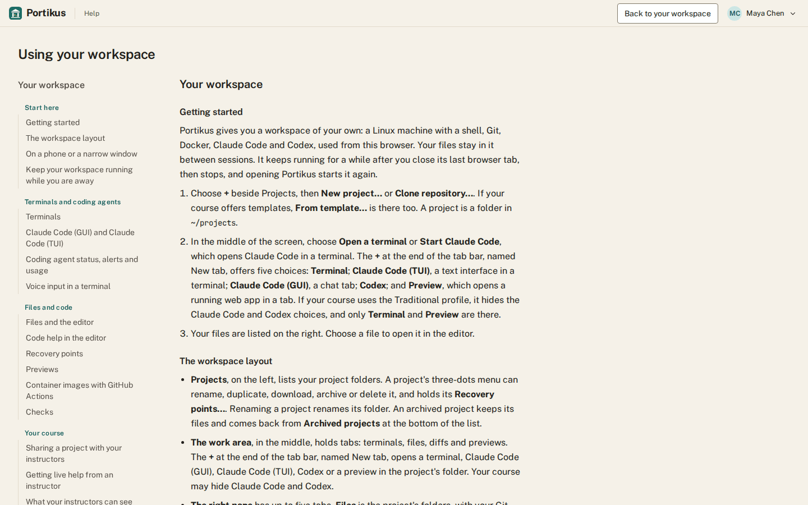

## Getting started

Portikus gives you a workspace of your own: a Linux machine with a shell,
Git, Docker, Claude Code and Codex, used from your web browser. Your files
stay in it between sessions. The workspace keeps running for a while after
you close its last browser tab, then stops. Opening Portikus starts it
again.

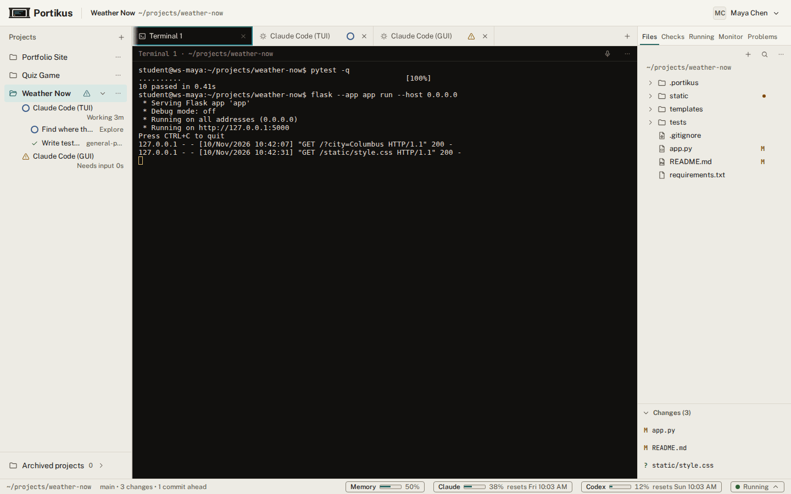

To start working:

1. Choose **+** beside Projects, then **New project…** or **Clone
   repository…**. If your course offers templates, **From template…** is
   there too. A project is a folder in `~/projects`.
2. In the middle of the screen, choose **Open a terminal** or **Start Claude
   Code**, which opens Claude Code in a terminal. If your course uses the
   Traditional profile, only **Open a terminal** is there.
3. Your files are listed on the right. Choose a file to open it in the
   editor.

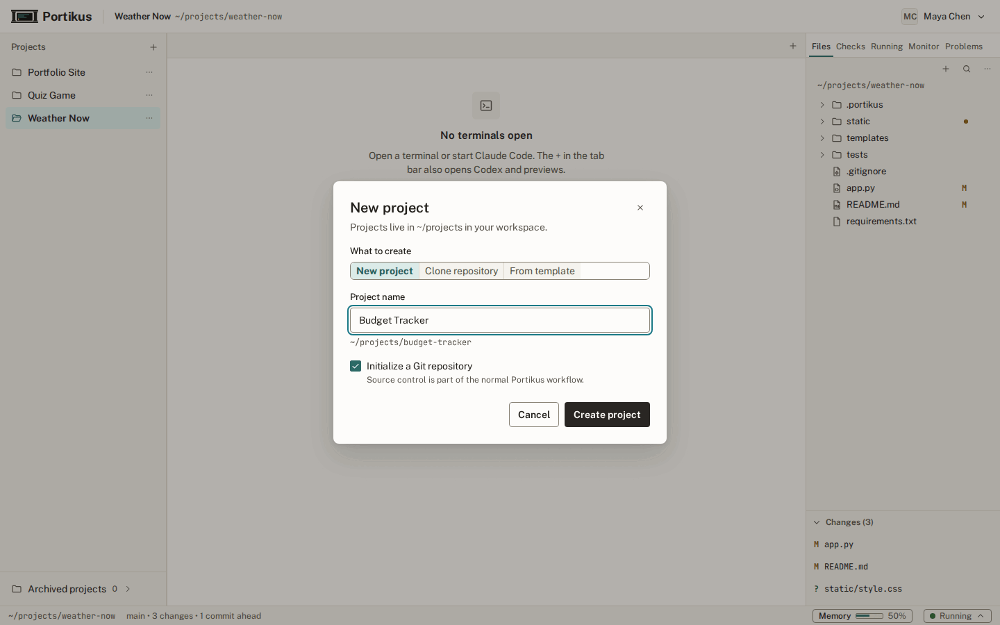

### The six New tab choices

The **+** at the end of the tab bar, named New tab, offers six choices.
The first five open in the project's folder:

- **Terminal**: a Linux shell.
- **Claude Code (GUI)**: Claude Code as a chat tab, with formatted replies,
  buttons and options. GUI means graphical user interface.
- **Claude Code (TUI)**: Claude Code in a terminal. TUI means text user
  interface: the program draws itself with text.
- **Codex (GUI)**: OpenAI's coding agent as a chat tab, like Claude Code (GUI).
- **Codex (TUI)**: Codex in a terminal.
- **Preview**: opens a web app that is running in your project in a tab
  inside Portikus.

If your course uses the Traditional profile, it hides the Claude Code and
Codex choices, and only **Terminal** and **Preview** are there.

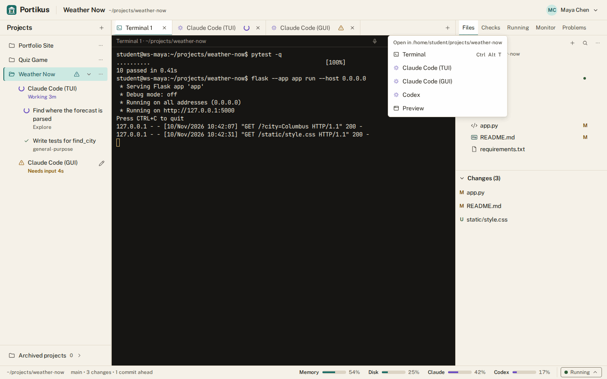

## The workspace layout

- **Projects**, on the left, lists your project folders. A project's
  three-dots menu can rename, duplicate, download, archive or delete it, and
  holds its **Recovery points…**. Renaming a project renames its folder. An
  archived project keeps its files and comes back from **Archived
  projects** at the bottom of the list.
  Under each project, the list also shows a row for each coding agent tab,
  and under an agent its subagents (see [Coding agent status, alerts and
  usage](#coding-agent-status-alerts-and-usage)).
- **The work area**, in the middle, holds tabs: terminals, chats, files,
  diffs and previews. The **+** at the end of the tab bar, named New tab,
  opens a terminal, Claude Code (TUI), Claude Code (GUI), Codex or a
  preview in the project's folder.
- **The right pane** has up to five tabs. **Files** shows the project's
  folders, with your Git changes listed underneath. **Checks** runs your
  project's checks, such as its tests. **Running** lists programs listening
  on a port. **Monitor** shows CPU, memory, disk and network use, and the
  processes running; **Stop** ends one of your programs, and the programs
  it started if you tick the box, or lowers its priority instead.
  **Problems** lists the errors and warnings in the files you have open. It
  appears only while code help is on for at least one language.
- **The status bar**, at the bottom, shows the project folder, the Git
  branch, memory and disk use, how much of its plan limit each coding agent
  has used, and your workspace's state. Choose the state
  to open **Your workspace**, where you can restart or stop it, see its
  storage, and reset Docker.

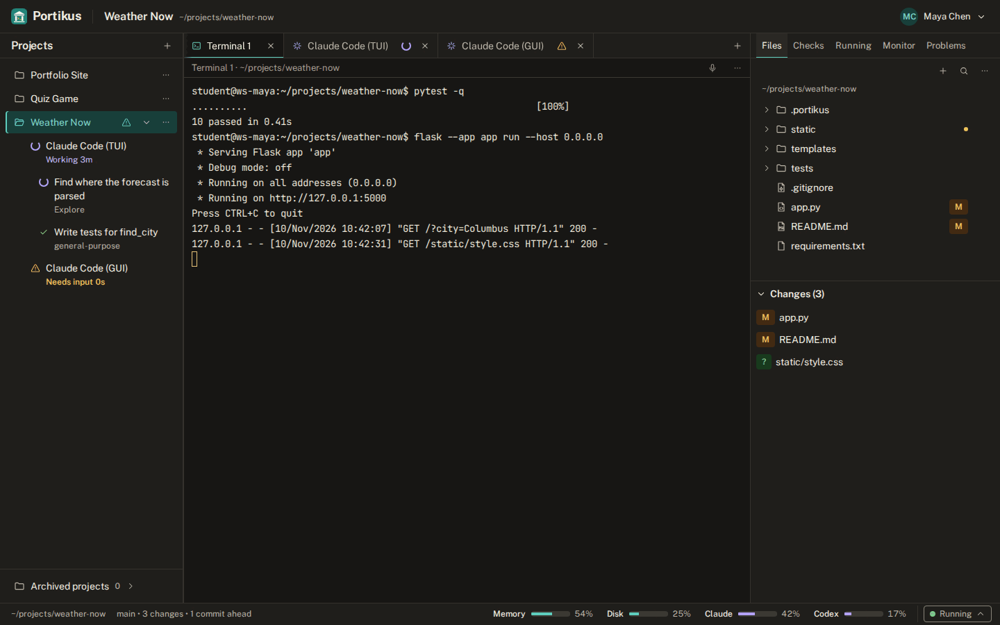

## Keep your workspace running while you are away

To leave a coding agent working while you are away, open **Your
workspace** from the status bar. Under **Keep running**, pick how long in
**Keep running for**, or type a clock time under **Or until** (a time
already past today means tomorrow), up to the limit your administrator
set, then press
**Keep running until …**, which shows the end time. Until then, closing
the page or leaving it idle does not stop the workspace. The status bar
shows "Kept running until" and the end time; a hold ending six or more
days ahead shows its date as well. To change it, pick another length and
press the button again. To let the workspace stop as usual again, press
**Don't keep running**. Afterwards the workspace stops as usual, with the
"Still working?" warning first. If your administrator has turned the
feature off, the section is not shown.

## Terminals

A terminal is a real Linux shell in your project folder. It keeps running
when you switch projects or close the browser, until the workspace stops.
Typing `exit` closes it.

- While a terminal has the keyboard, the Tab key goes to the shell. Press
  **Alt+Shift+Q** to leave the terminal; focus moves to the tabs.
- A terminal's three-dots menu splits it right or down, moves it to a new
  tab, renames it, switches it between light and dark, or closes it. The
  picture at the top of this guide shows one tab split into two terminals.
- You can drag a terminal's title bar onto another pane or tab. Without
  dragging, choose **Move into** in its three-dots menu and pick a tab; the
  terminal joins that tab's split. **Reset pane sizes** in the same menu
  gives every pane in the tab an equal share again.
- Right-click a tab, or press **Shift+F10** on it, for **Move left**,
  **Move right** and **Close tab**.
- Drag a file from your desktop, or from the file tree, onto a terminal to
  type its path at the cursor. Portikus never presses Enter. A file from
  your desktop is first saved in the project's `.portikus/pastes` folder,
  and saved files there are removed after 7 days. Content dragged from
  other pages is ignored. A name with a control character, or a file over
  50 MiB, is refused.
- When an agent in another tab finishes or needs you, a message pops up.
  **F8** moves to the newest one, even from inside a terminal.
- After the workspace stops or restarts, an old terminal says it ended.
  Choose **New terminal here** to open a fresh one in its place.

### Voice input

You can talk instead of typing. Hold down the microphone button in a
terminal's title bar, or hold **Alt+Shift+M** while the terminal has the
keyboard, and speak. Listening stops when you let go. With the keyboard on
the microphone button, holding Space or Enter works too. The words appear
at the bottom of the terminal as they are heard, then are typed at the
prompt. Voice input never presses Enter, so check the text and press Enter
yourself.

Your browser does the listening, not Portikus. The audio goes to your
browser maker's speech service: Google for Chrome, Microsoft for Edge, and
Apple for Safari. Portikus does not receive the audio and keeps no record
of what you said. Firefox and Brave do not offer voice input, so the button
does not appear there, and neither does it when your administrator has
turned voice input off. The first time, the browser asks to use your
microphone.

## Claude Code and Codex

Claude Code and Codex are coding agents: programs that read your code, run
commands and change files when you ask them in plain language. Sign in to
each one inside the workspace, as you would on your own computer. Portikus
never sees your sign-in.

- **Claude Code (TUI)** and **Codex (TUI)** run in a terminal tab. Everything
  in [Terminals](#terminals) applies to them, voice input included.
- **Claude Code (GUI)** and **Codex (GUI)** are chat tabs, described next.

Do not run a GUI tab and a TUI terminal on the same Claude or Codex session
at once. After a Claude chat tab is closed, running `claude --resume` in a
terminal continues it.

### The chat tab

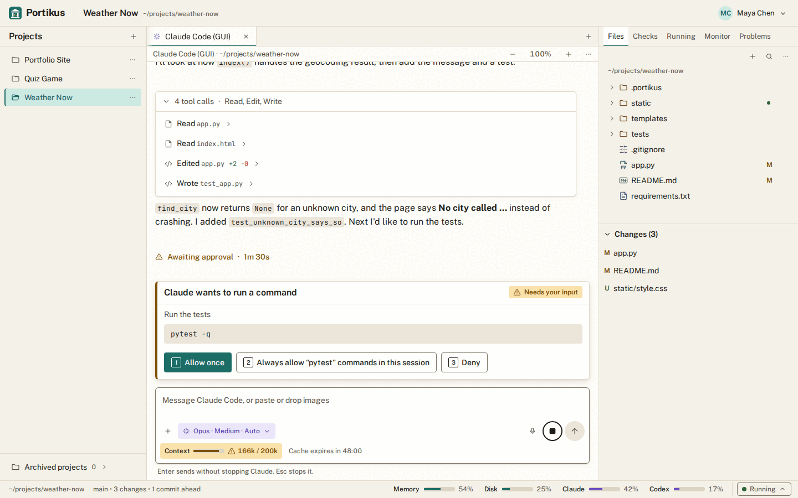

Replies appear as formatted text, Claude's work is folded into a "Worked
for" row, and when it needs a permission or asks a question you answer on a
card. Code in replies has a language label and syntax colours.

**The message box.** Enter sends and Shift+Enter adds a line; in a code
block, Ctrl+Enter (Cmd+Enter on a Mac) sends. The box understands Markdown
as you type: stars for bold and italic, backticks for code, and a dash, a
`#` or three backticks at the start of a line for a list, a heading or a
code block. You can paste, drop or attach images. Pasting more than 40
lines attaches them as a text file; paste again straight away to put them
in the box instead. Up in an empty box brings back your last message, and
Esc stops Claude.

**Chat options** is the button under the message box that summarises your
choices, such as "Opus · Medium · Auto". It opens a panel where you choose
the agent, the model, the effort and the permission mode. A new chat starts with what you last chose in that
project, except that **Bypass permissions**, which lets Claude act without
asking, is never carried over; a new chat starts in Auto instead. A warning
shows while Bypass permissions is on.

The Permissions choice has five modes:

- **Ask** asks before Claude edits files or runs commands.
- **Accept edits** lets it edit files on its own but asks before commands.
- **Plan** lets it read and plan but change nothing; when the plan is
  ready, it asks you to approve it.
- **Auto** runs what Claude judges safe and asks about the rest.
- **Bypass permissions** runs commands and changes files without asking.

**The `/` and `@` menus.** Type `/` at the start of a message to see
Claude's commands, or `@` anywhere to pick a project file. The arrow keys
move, Enter inserts and Escape closes the list. Commands that only work in
the terminal are greyed out; `/model` and `/effort` open Chat options
instead. The `@` list shows files only, and skips files your `.gitignore`
leaves out.

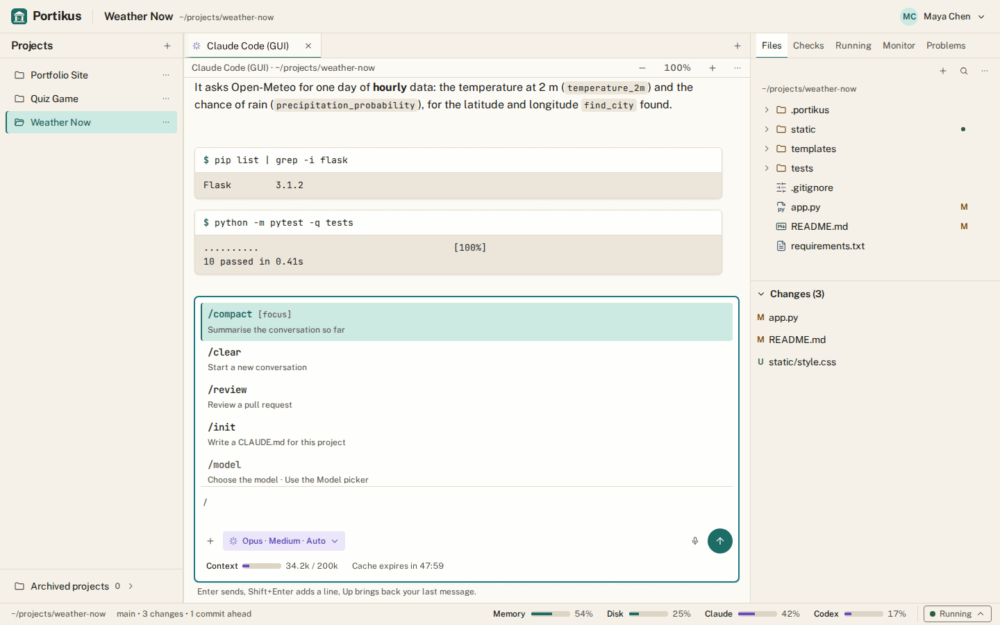

**Shell commands.** Start a message with `!` to run it as a shell command
in the project folder. The box shows a Shell label while you type it. The
command and its output appear in the conversation, and Claude sees them
with your next message. A command stops after two minutes, only the first
64 KiB of its output is kept, and it cannot ask you questions, so use a
terminal for those. You cannot run one while Claude is working. Stop, or
Esc, ends a command that is still running.

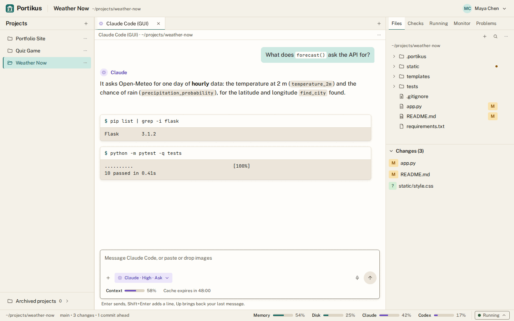

**Permission cards.** Press 1, 2 or 3 to choose an option; the keys work
only on the card, never while you type. **Deny** opens a line, "Tell
Claude what to do instead": type a reason and press Enter, or press Enter
with nothing typed to deny without one. Escape goes back to the buttons.
When you have chosen "Always allow" for something, a line in Chat options
says so, and the list "Allowed without asking in this session" lets you
revoke each rule.

**Plan mode.** When Claude offers a plan, choose **Yes, and accept edits**
to let it change files without asking, **Yes, and ask before edits** to
approve each change, or **No, keep planning**, which also opens the reason
line. Your choice sets the Permissions choice.

**Sending while Claude works.** You can still send a message; Claude reads
it at its next step and it is marked "Sent while Claude was working". If
Claude does not act on it, stop Claude and send it again.

**Memory and changed files.** Under the Chat options button, Portikus shows how full
Claude's memory of the chat is once it passes half, and how long until the
prompt cache goes cold. While the cache is warm, your next message is
faster and uses less of your limit. When the memory is high, type
`/compact`. `/clear` starts a fresh conversation in the same tab. When
Claude edits files, a line under its reply says how many changed; open it
to see each file.

**Read aloud.** A speaker button under each reply reads it aloud; press it
again to stop. Turn on **Read replies aloud** in Chat options to hear the
last reply of each turn. Escape, sending a message or leaving the tab stops
the speech, and code blocks are read as "code block". Your browser makes
the voice. If it has only an online voice for your language, such as
Chrome's Google voices, the reply's text goes to the browser's maker to be
spoken.

**After a restart.** A chat tab keeps running when you close the browser.
When the workspace has stopped and started again, choose **Resume chat** on
the ended tab to carry on. A reply still being written when the workspace
stopped is lost.

### Codex in the chat tab

**Codex (GUI)** works like the Claude Code chat tab: the same rows, cards,
message box, `!` commands and Chat options. The differences:

- The Permissions choice has Codex's own five modes: **Ask**, **Read only**,
  **Plan**, **Auto** and **Full access**. Full access runs anything without
  asking, shows a warning, and is never carried into a new chat.
- Codex's skills start with `$`; type `$` at the start of a message to see
  them. Claude Code's start with `/`.
- A permission card offers **Allow once**, **Deny** and sometimes **Allow
  for this chat**, never "Always allow". The rules list does not show what
  you allowed for this chat; a new chat clears it.
- The memory meter shows tokens only, with no cache countdown. A question
  Codex asks in a **Codex (TUI)** terminal has no card in the browser;
  answer it in the terminal.
- Sign in to Codex in a **Codex (TUI)** tab, or run
  `codex login --device-auth` in a terminal.

**Switching agents.** To change agent in the middle of a chat, open **Chat
options** and choose the other agent. Portikus warns you first: the new
agent starts fresh with this conversation as context, and the cache is lost,
so the next message may use more of your limit. Each tool call is reduced to
a short summary, and if the conversation would not fit, the oldest turns are
left out. A line in the conversation marks the switch. You cannot switch
while a reply, a card or a `!` command is running.

## Coding agent status, alerts and usage

A tab running Claude Code or Codex shows what the agent is doing, in the
tab and in the project list. The mark has a shape as well as a colour, and
the tab's name says it too:

- An open ring means the agent is working.
- A triangle means it needs your input, such as a permission.
- A check means it has finished. A bold tab name means you have not looked
  at it yet. The marks forget this when you reload the page.

A project shows the most urgent state of its tabs, so you can see an agent
in another project that is waiting for you. Under each project, a row for
each agent tab says what it is doing and for how long, such as "Working
4m", and under an agent its subagents are listed with their description,
type and state. Select a row to go to its tab; in a chat, selecting a
subagent opens that step of the conversation. The arrow button beside a
project hides or shows its agents. Rows appear after the agent's first
report. A Codex subagent shows its type and no description. If you stop
Claude Code with Esc in a terminal, its tab keeps showing "working" until
you type your next prompt.

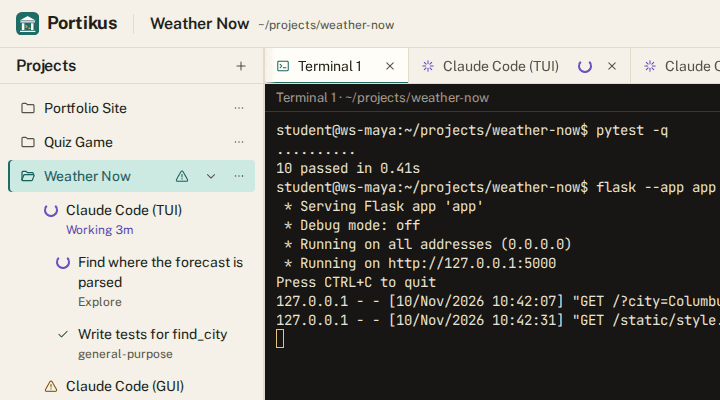

**Alerts.** When an agent finishes or needs input in a tab you are not
looking at, a message pops up; for another project it has **Open
project**. These messages are not kept in Notifications. **F8** moves to
the newest one, and Tab reaches its buttons.

**Desktop notifications.** Portikus can also notify you from your computer
when the page is hidden or not focused. The notification names only the
agent and what it needs, never a project or terminal. Choose **Ask me**,
**On** or **Off** under **Desktop notifications** in Settings, Preferences.
Choosing On saves your choice; press **Allow in this browser** to let the
browser show them. If the browser blocks them, allow notifications for this
site in its site settings.

**Usage.** The status bar shows how much of each agent's seven-day plan
limit you have used and when it resets, for example "Claude 91% resets Thu
7:21 PM". Choose it for the details. A message warns you once when a limit
passes 85 percent. If you sign in with an API key, which has no plan limit,
the bar shows your tokens and cost for today (in UTC) instead. The numbers
update about every five minutes.

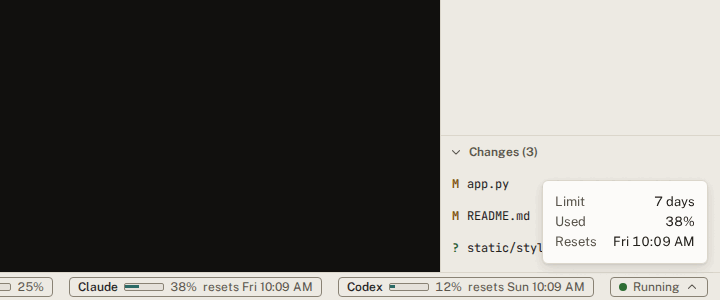

## Files and the editor

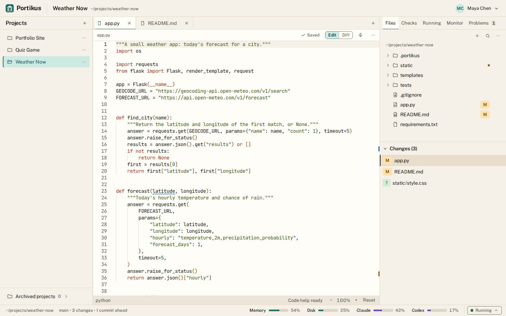

- Choose a file in Files, or press Enter on it, to open it. The editor saves
  a few seconds after you stop typing. You can change the delay, or turn
  auto-save off, in Settings. **Ctrl+S** saves at once.
- A Markdown file shows a preview beside the source.
- A letter beside a file shows its Git state: **M** modified, **A** added,
  **D** deleted, **R** renamed, **?** new and not yet tracked, **!** in
  conflict. **Diff** shows what changed since your last commit.
- Right-click a file, or press **Shift+F10**, for new file, new folder,
  rename, move, download, upload and delete.
- **Copy path**, in a file's menu, copies its full path, quoted for the
  shell; with several files selected it copies all of them. Paste it into a
  terminal: it is the keyboard way to drag a file onto a terminal.
- **Find in files** is the magnifier at the top of Files.

## Code help and the Problems tab

For Python, TypeScript and JavaScript files, the editor gets help from a
language server: a program inside your workspace that understands the
language. Your administrator chooses which languages have code help. For a
language that is on:

- **Completion**: suggestions as you type. **Ctrl+Space** asks for them.
- **Hover**: rest the pointer on a name to see what it is. From the
  keyboard, press **Ctrl+K** then **Ctrl+I** (Command on a Mac).
- **Go to definition**: **F12** opens where a name is defined.
- **Rename**: **F2** renames a name everywhere in the project. It changes
  at most 20 files, and either all of them change or none do.
- **Format**: **Format Document**, in the **F1** command list, tidies the
  file. Python is formatted with Ruff.
- **Errors and warnings** are underlined in the file and listed in the
  **Problems** tab.

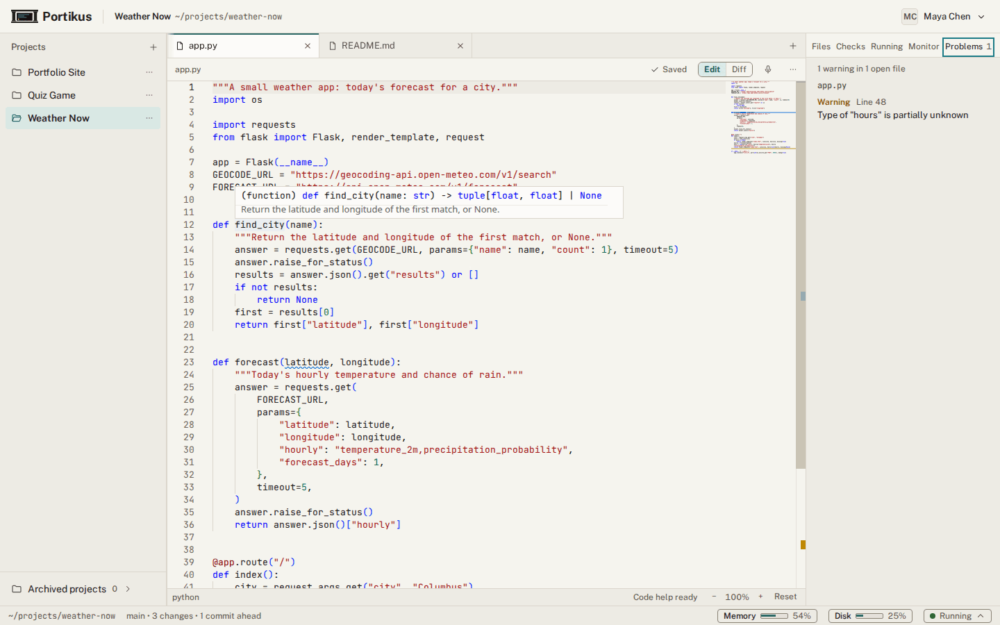

**Problems** lists the errors and warnings in the files you have open,
grouped by file. Choose one to open the file at that line. Closing a file
removes its problems; Checks covers the whole project. **Alt+F8** and
**Shift+Alt+F8** move to the next and the previous problem.

The bar under the file shows the language server's state. Editing never
waits for it.

- **Code help starting**: suggestions and problems arrive when it is ready.
- **Code help ready**: everything works.
- **Code help unavailable**: the server is not installed, or it stopped
  several times and is resting for about five minutes. **Restart** tries
  again.
- **Code help stopped**: the server crashed, perhaps out of memory. Stop a
  program you do not need from Monitor, then choose **Restart**.
- **Code help is on in another window**: only one window at a time has code
  help for a project. Choose **Use here** to move it.
- Nothing shown: the server is resting after 15 minutes without use (your
  next edit wakes it), or code help is off for that language.

A file over 512 KB gets no code help. Other languages, such as C, C++ and
Java, have no code help yet.

## Recovery points

A recovery point is a saved copy of one project's files. To see them, open the
project's three-dots menu and choose **Recovery points…**. **Create recovery
point now** makes one at once.

- Portikus makes one every 15 minutes while the project has changed. It also
  makes one before you archive the project, before a Claude Code or Codex
  session starts, before an administrator rebuilds your workspace or replaces
  your home folder, and before a restore.
- Points are kept for 14 days. If your recovery storage fills up, the oldest
  points go first. The newest point of each project is always kept.
- Some folders are left out because they can be built again: `node_modules`,
  `.venv`, `dist`, `build`, `target` and `__pycache__`. To leave out more, add
  a `.workspaceignore` file to the project folder. It works like `.gitignore`:
  one pattern per line, such as `big-data/`. A line like `!dist/` puts a
  default folder back in.
- A restore puts back the whole project, Git's own records included, so
  commits made since then leave the folder too. Portikus saves the current
  state as a new recovery point first, so you can go back. It never makes a
  Git commit for you.
- If a restore cannot finish, your earlier files are kept in a hidden folder
  named `~/projects/.portikus-aside-` followed by the point's ID. The
  Recovery points dialog lists it under **Kept folders** while the
  workspace is running. Copy back what you need, then press **Delete…**
  there. Portikus never deletes it on
  its own, and it will not restore that same point again until the folder is
  gone.

## Previews

When your web app is listening on a port, it appears under **Running**.

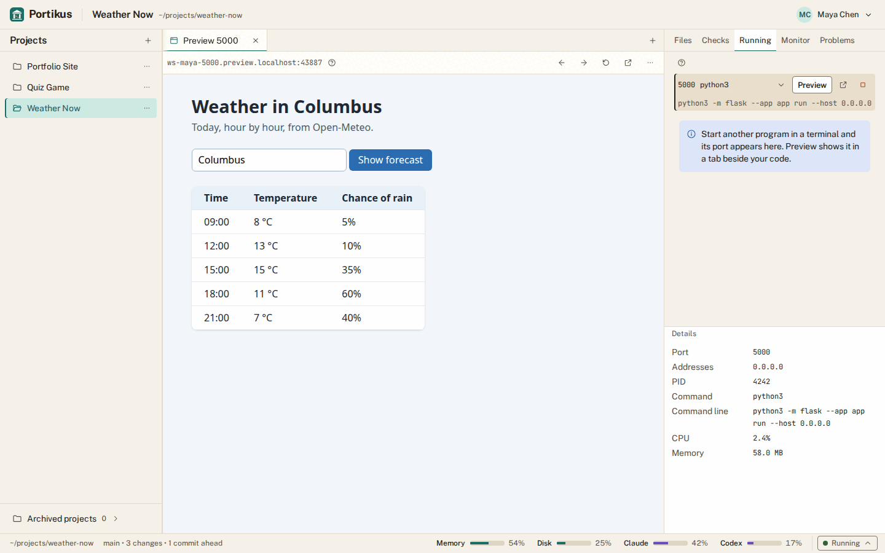

- **Preview** opens the app in a tab inside Portikus. The button beside it
  opens it in a new browser tab.
- Only you can open your previews, after signing in. There are no public
  links.
- If Vite or webpack-dev-server refuses the preview host, the preview shows
  one line to add to its config file. Add it, restart the server, then
  choose **Retry**.
- Ports below 1024 cannot be previewed, and neither can a few reserved ones
  such as SSH, Docker and PostgreSQL. Run your web app on a port from 1024
  up, such as 3000 or 5173, then choose **Choose another port…** in the
  preview.

## Container images with GitHub Actions

Build and push your own images from GitHub Actions, then pull them in your
workspace. Actions runs on GitHub's machines and pushes to ghcr.io with the
repository's built-in `GITHUB_TOKEN`, so no password is needed. Put this in
`.github/workflows/image.yml` (the repository name in the tag must be
lowercase):

```yaml
name: image
on: push
jobs:
  build:
    runs-on: ubuntu-latest
    permissions:
      contents: read
      packages: write
    steps:
      - uses: actions/checkout@v4
      - uses: docker/login-action@v3
        with:
          registry: ghcr.io
          username: ${{ github.actor }}
          password: ${{ secrets.GITHUB_TOKEN }}
      - uses: docker/build-push-action@v6
        with:
          push: true
          tags: ghcr.io/${{ github.repository }}:latest
```

After the first run, open the package on GitHub (your profile, then
**Packages**), and under **Package settings** make it public. Then, in a
terminal in your workspace, run `docker pull ghcr.io/<owner>/<image>:<tag>`,
or start a Dockerfile with `FROM ghcr.io/<owner>/<image>:<tag>`. No
`docker login` is needed.

Portikus caches ghcr.io unless your administrator turned that off. While it
does, inside your workspace:

- `docker push` to ghcr.io does not work. Push from GitHub Actions instead.
- Private ghcr.io images cannot be pulled. Make the package public.
- `docker login ghcr.io` reports success without checking anything.
- Tools other than Docker, such as curl, `gh` and ORAS, get certificate
  errors for ghcr.io.

## Checks

Checks are commands your project lists in `.portikus/checks.json`, such as
`npm test`. Open **Checks** and press the run button beside one to see its
real output. The three-dots button, **Edit checks**, changes the list.

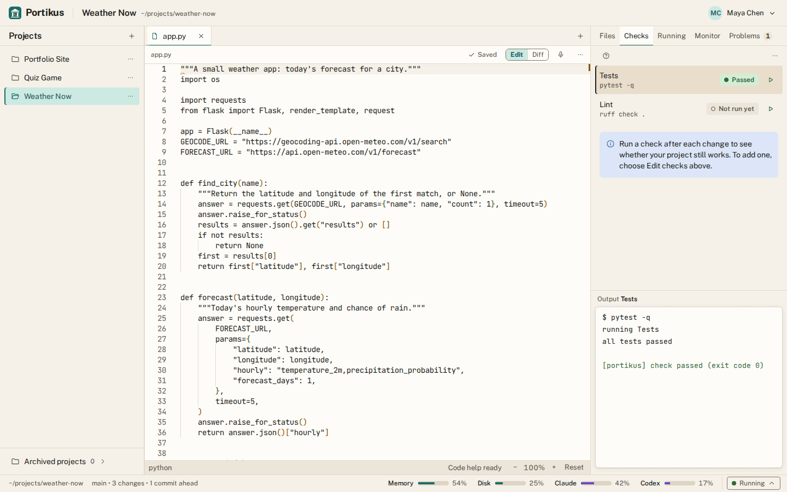

## Sharing a project with your instructors

Your instructors cannot see your work unless you choose to share it. To share
one project, open its three-dots menu and choose **Share with my
instructors…**, then **Start sharing**.

- The instructors of the courses you belong to can then look at that project
  and nothing else. They cannot change anything.
- They see the project's files, its Git status and changes, and the latest
  check results. They never see your terminals, your previews, or secret
  files such as `.env`, `.env.local`, keys and `.npmrc`.
- The share ends by itself after 24 hours. **Stop sharing** in the same dialog
  ends it at once. A shared project has a **Shared** tag in the project list.
- The dialog lists each instructor who has looked and when they last did.
  Portikus also sends you a notification the first time an instructor opens
  the project.

## Getting live help from an instructor

To have an instructor look at a problem with you, open the project's
three-dots menu and choose **Get live help…**. Choose one instructor of
your courses, read what they will see, then press **Start live help**.
They get a notification.

- They see the terminals and previews of that project, from what is on
  each screen when they open it. They do not see earlier output.
- Typing is off at first, so they can only watch. A bar across the top of
  the page names them and has **Let them type**. Only you can turn typing
  on, and **Stop typing** turns it off at once.
- Letting them type gives them a full shell as you. That includes your Git,
  Claude, Codex and SSH credentials, every file in your workspace, and your
  other terminals. Turn it on only while you are watching.
- Live help lasts at most 60 minutes. **End live help** in the bar ends it
  at once. It also ends when the instructor leaves or the project is
  archived. One session can be open at a time.

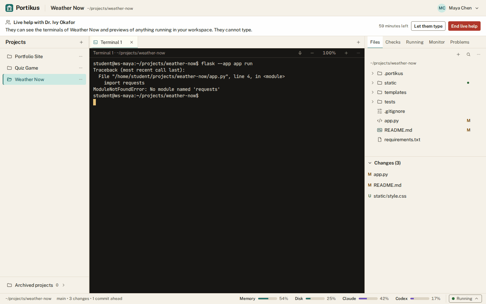

## What your instructors can see about coding agents

Instructors of your courses, and administrators, can see counts of your use of
Claude Code and Codex: how many sessions you ran, how many tokens they used,
the estimated cost, and how many lines were added and removed. They never see
your prompts, the agents' answers, or your code. These counts do not need you
to share anything. You see your own counts for today in the status bar when
your agent reports no plan limit.

## Settings

Open **Settings** from the menu under your name. Your settings follow you to
any browser you sign in from.

- **Profile** shows what your institution's sign-in provides, and lets you
  add a picture and links.
- **Preferences** covers the color scheme, editor auto-save and word wrap,
  terminal colors, screen reader mode, desktop notifications for coding
  agents and your workspace's timezone.
- **Password** appears when your account has a Portikus password, and
  changes it.

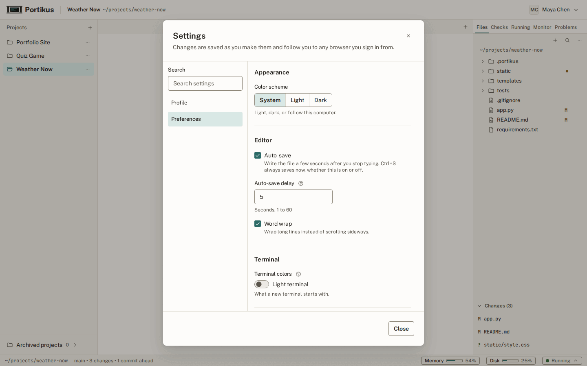

## On a phone or a narrow window

On a phone or a narrow window the work area fills the screen, and the side panes become drawers. The
**Projects** button, left of the Portikus name, slides your project list in
from the left, and the **Files** button, at the right of the top bar,
slides the right pane in from the right. Choosing a project or opening a
file closes it again, and so do Escape, its close button and a tap outside
it.

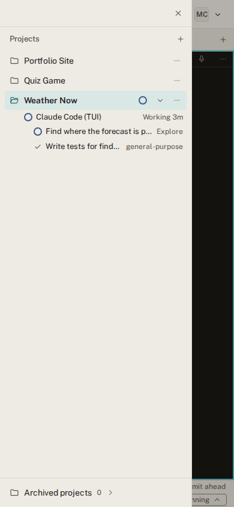

## If you forget your password

This works only when your account has a Portikus password and your site
sends account email. If you sign in through your school's own sign-in
page, your school handles forgotten passwords instead.

1. On the sign-in page, choose **Forgot your password?**.
2. Enter the email address you sign in with and choose **Email me a link**.
   The page gives the same answer whatever address you type, so it never
   tells anyone whether an account exists.
3. Open the link in the email. It works once and lasts 30 minutes. Asking
   again sends a new link, and the older one stops working.
4. Choose a new password of at least 15 characters, type it twice, and
   save it.

Saving signs out every session of your account, on every device, and an
email tells you the password was changed. Then sign in with the new
password. If you use two-factor sign-in, you still need your code or
passkey. If no email arrives, ask your administrator.

## Keyboard and screen readers

These keys are hard to discover:

| Keys | What they do |
|---|---|
| Alt+Shift+Q | Leave a terminal. While a terminal has the keyboard, Tab goes to the shell. Each terminal's three-dots menu also has Leave terminal. |
| Alt+Shift+M | Hold while a terminal has the keyboard to talk into it; let go to stop. |
| Ctrl+M, or Ctrl+Shift+M on a Mac | In the editor, switch whether Tab types a tab or moves focus out of the editor. |
| Alt+Shift+Left Arrow, Alt+Shift+Right Arrow | Move the focused tab left or right. Delete closes it. A tab's menu also has Move left and Move right. |
| Shift+F10 | Open the menu of the focused tab, or of the focused row in the file tree. The Menu key does the same. |
| F8 | Move to notifications, from anywhere, the editor and a terminal included. Move to the newest one, then press Tab to reach its buttons, such as Open project. |
| Ctrl+Space | In the editor, show suggestions for the name you are typing. Code help must be on. |
| Ctrl+K, then Ctrl+I | In the editor, show what the name at the cursor is, in a box a screen reader can read. Use Command on a Mac. Code help must be on. |
| Alt+F8, Shift+Alt+F8 | In the editor, go to the next or the previous problem. Code help must be on. |

What the terminal and editor cannot do:

- Terminals are silent to a screen reader until you turn on Screen reader
  mode in Preferences. With it on, output is read as plain lines of text:
  colors, bold, and layout are not announced.
- With Screen reader mode on, a terminal takes only typed keys. Text from an
  emoji picker, dictation, or some on-screen keyboards is dropped.
- Full-screen programs such as vim, htop, and agent command lines redraw the
  whole screen, so a screen reader may read repeated or partial lines. There
  is no way to review what they draw other than moving through the lines.
- The editor reads the current line. Colours, such as the diff view's added
  and removed lines, are not read out. F1 opens the editor's command list.

## When something goes wrong

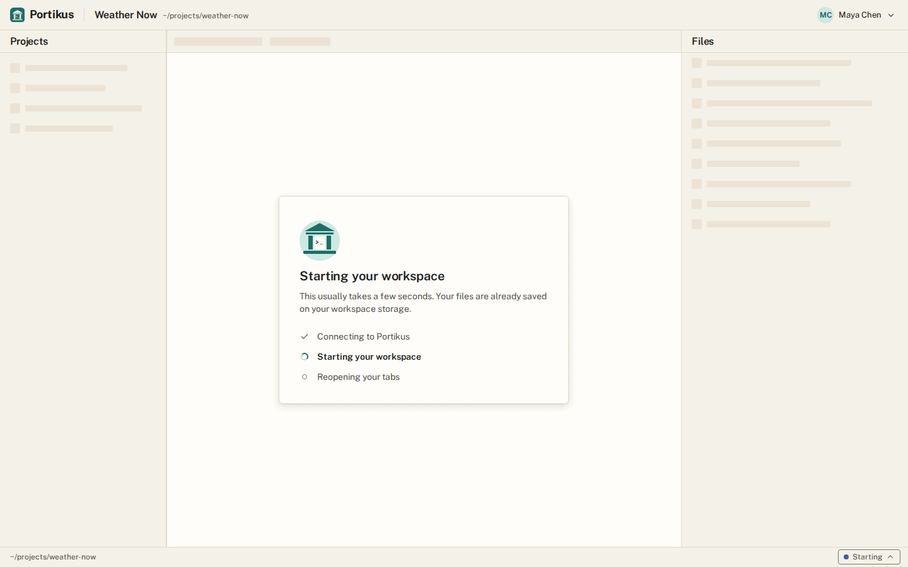

- **Starting your workspace** usually takes a few seconds. Your files are
  already saved.
- **Waiting for room for your workspace** means the server has no room for
  a new workspace yet, and administrators have been told. Leave the page
  open or come back later.
- **Your workspace could not be started**: read the sentence under the
  heading, which says why. If Docker's storage is full, **Reset Docker…**
  frees it and keeps your projects and home folder.
- **You're disconnected from your workspace**: Portikus is trying to
  reconnect. If no window reconnects before the time shown, the workspace
  stops. Your files are saved, but running terminals and previews end.
  Choose **Reconnect now** to try at once.
- **Still working?** You have not typed or clicked in Portikus for a while,
  so the workspace will stop soon. Programs running on their own do not
  count. Choose **Keep working**, or press any key, to keep it running.
- **Your workspace has been slowed down**: it kept its CPUs busy for a long
  time. The notice says how it gets back to full speed. Stop a program you
  do not need from Monitor.
- **Your workspace has been near its memory limit**: if it runs out, the
  biggest program is stopped. Stop a program you do not need from Monitor.
- **You deleted or broke something**: open the project's three-dots menu
  and choose **Recovery points…** (see [Recovery points](#recovery-points)).
  Portikus saves the current state as a new recovery point before a
  restore, so you can go back.
- **Your session ended**: sign in again. Your projects are where you left
  them.
- **Something else**: every message that pops up is kept in
  **Notifications**, in the menu under your name. Read it again there, then
  tell your instructor what it said.

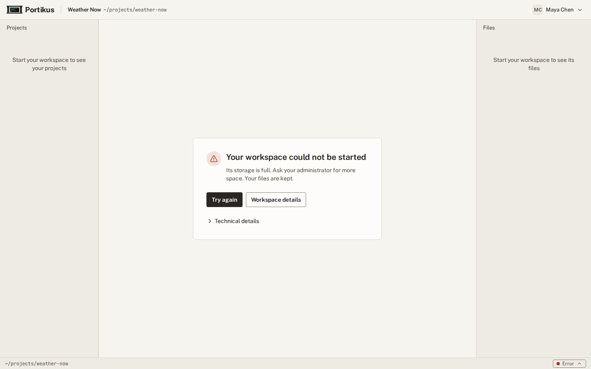
